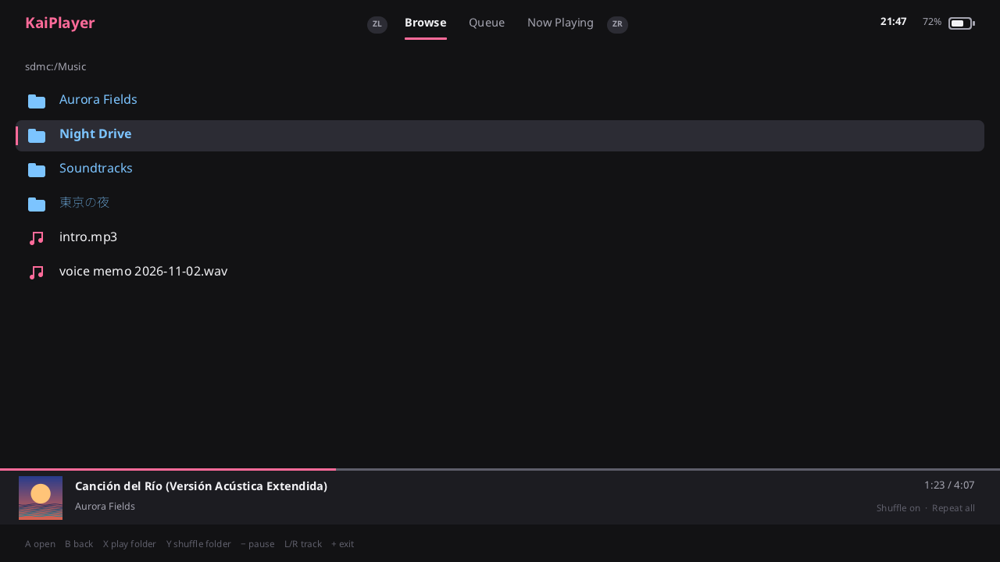

# KaiPlayer

An **open-source homebrew music player** for **Switch 2** running
[kaiHEN](https://github.com/ouncebrew/kaihen). Pick a folder on your microSD
card and KaiPlayer plays the music in it.


| Browse | Playlists | Queue |
|--------|-----------|-------|
|  |  |  |

> KaiPlayer is an independent project. It is not affiliated with, endorsed by
> or sponsored by Nintendo. See the [Legal notice](#legal-notice).

- [For users: install the .nro](#for-users-install-the-nro)
- [Supported audio formats](#supported-audio-formats)
- [Controls](#controls)
- [Touch screen](#touch-screen)
- [Settings](#settings)
- [Playlists](#playlists)
- [Resume where you left off](#resume-where-you-left-off)
- [Song details and album art](#song-details-and-album-art)
- [File names and tags](#file-names-and-tags)
- [Troubleshooting](#troubleshooting)
- [For developers: build from source](#for-developers-build-from-source)
- [Legal notice](#legal-notice)
- [License](#license)

---

## For users: install the .nro

You don't need to build anything. Everything is copied over Wi-Fi with
OunceShell's FTP server, so the microSD card stays in the console.

> **Don't take the microSD card out while kaiHEN is running.** Removing it
> means restarting the console, and kaiHEN has to be started again after
> that.

### Requirements

- A Switch 2 with **kaiHEN** running. Launch a game while holding **R** to open
  the homebrew menu (hbmenu).
- **OunceShell**, which comes with kaiHEN.
- A PC on the same Wi-Fi network as the console, with an FTP client such as
  [FileZilla](https://filezilla-project.org/).

### 1. Download

Go to the repository's **[Releases](../../releases)** page and download
`KaiPlayer.nro` from the latest release.

### 2. Copy the .nro to the console

1. In hbmenu, open **OunceShell** and start its FTP server. OunceShell shows
   the console's IP address and port (for example `192.168.0.51`, port
   `1337`).
2. In FileZilla, enter that address as **Host** and that number as **Port**,
   leave **Username** and **Password** empty, and click **Quickconnect**.
3. In the remote pane (the console), open the `switch` folder. Create it if
   it doesn't exist.
4. Drag `KaiPlayer.nro` from your PC into `switch`. Its path on the card is
   then `sdmc:/switch/KaiPlayer.nro`.

To update KaiPlayer later, upload the new `KaiPlayer.nro` the same way and
let it replace the old one.

### 3. Copy your music

1. With the same FTP connection, create a folder for your music, for example
   `Music`.
2. Drag your album folders into it. Subfolders (artist, album and so on) are
   fine.

> **Use plain letters (A–Z, no accents) in file and folder names.** On
> Switch 2, a file or folder whose name has any character outside basic
> ASCII (accents such as `á é ñ ü`, or Japanese) is saved, but no app can
> list it, KaiPlayer included. Rename such files on your PC before uploading
> them, for example `06 Canción.mp3` → `06 Cancion.mp3` or
> `04 みずいろの雨.mp3` → `04 Mizuiro no Ame.mp3`. KaiPlayer still shows the
> song's real title, artist and album, with accents or in Japanese, from its
> tags. See
> [File names and tags](#file-names-and-tags).

### 4. Play it

1. Open hbmenu (launch a game while holding **R**) and select **KaiPlayer**.
2. Use the D-pad to go to your music folder.
3. Press **X** to play the whole folder, subfolders included. Or press **A**
   on a song to start from that song.

KaiPlayer remembers the last folder and the shuffle and repeat modes. It
saves them in `sdmc:/config/kaiplayer/settings.txt`.

---

## Supported audio formats

All of these formats are **open and royalty-free**. The decoders are built into
the `.nro`, so you don't need to install anything else.

| Format         | Extensions     | Notes                                                 |
|----------------|----------------|-------------------------------------------------------|
| **MP3**        | `.mp3`         | CBR and VBR. The MP3 patents expired in 2017.         |
| **FLAC**       | `.flac`        | Lossless, 8 to 32 bits.                               |
| **Ogg Vorbis** | `.ogg`, `.oga` | Vorbis only. `.ogg` files that contain Opus don't play. |
| **WAV**        | `.wav`         | PCM, IEEE float, A-law and µ-law.                     |

- **Sample rates:** any sample rate works (44.1 kHz, 48 kHz, 96 kHz and so on).
  KaiPlayer converts it to the console's 48 kHz.
- **Channels:** mono is played on both channels. For files with more than two
  channels, KaiPlayer plays the front left and front right channels.

**Not supported yet:** Opus, AAC/M4A, ALAC, WMA and DRM-protected files. AAC
and WMA won't be added, because they need paid licenses.

---

## Controls

KaiPlayer has four tabs: **Browse**, **Playlists**, **Queue** and **Now
Playing**. Press **ZL** / **ZR** to move between them. Starting a song keeps
you where you are; open Now Playing with **ZR** or by tapping the player bar.

| Button    | Browse                       | Playlists                    | Queue                      | Now Playing                |
|-----------|------------------------------|------------------------------|----------------------------|----------------------------|
| ↑ ↓ / LS  | Move (↑ from the first row selects **‹ Back**) | Move (same)     | Move                       | ↓ selects **Add to playlist**, ↑ leaves it |
| →  / ←    | Select the row's add-to-playlist button / back to the row | Same, inside a playlist | Same                 | Rewind / fast-forward 10 s |
| A         | Open folder / play from song (or press the selected **‹ Back** or add-to-playlist button) | Open playlist / play from song | Play this track | Pause / resume (or add, when **Add to playlist** is selected) |
| B         | Go up one folder             | Back to the playlist list    | Back to Browse             | Add the song to a playlist |
| X         | Play the whole folder        | Play the playlist            | Shuffle on / off           | Shuffle on / off           |
| Y         | Shuffle the whole folder     | Shuffle the playlist         | Repeat: off / queue / song | Repeat: off / queue / song |

In every tab:

| Button  | Action |
|---------|--------|
| ZL / ZR | Previous / next tab |
| L / R   | Previous / next track |
| −       | Pause / resume |
| RS ← →  | Rewind / fast-forward 10 s |
| RS ↑ ↓  | Previous / next page of a list |
| +       | Open the menu. Press **+** again to exit KaiPlayer: it asks you to confirm. |

### The + menu

**+** opens a menu with actions for the current tab:

| Tab         | Menu items |
|-------------|------------|
| Playlists   | New playlist, rename or delete a playlist; inside a playlist, move or remove a song |
| Queue       | Save the whole queue as a playlist |
| All         | Turn screen off (while music plays), Settings, and Exit KaiPlayer (asks you to confirm) |

Adding songs to a playlist isn't in the menu: use the add-to-playlist
buttons, a list with a small plus (see
[Playlists](#playlists)).

Use ↑ ↓ and **A** to choose, and **B** to close the menu. To exit, press
**+** twice and confirm with **A** (or press **+** a third time).

Use the console's volume buttons to change the volume; KaiPlayer plays at
full level and has no volume of its own. The top right corner shows the
time and the battery level (green while charging, red at 15% or less).

**X** and **Y** also play the subfolders. When you press them in the root of
the card, KaiPlayer skips the system and homebrew folders there (`switch`,
`config`, `Nintendo`, `atmosphere`, kaiHEN's folders and so on), so their
sound effects don't end up in the queue. The queue shows the folder each
track comes from.

Song rows in Browse, Playlists and Queue show the song's **title**,
**Artist** and **Album** from its tags, like Now Playing. They are read in
the background, so they appear a moment after a list opens; until then, and
for songs without tags, the row shows the file name (and the folder name in
grey instead of the album). The song
that is playing has moving bars next to its name (still while paused).

**Repeat queue** plays the whole queue again after its last song. **Repeat
song** plays the current song over and over. With **Shuffle on**, the Queue
tab lists the songs in the shuffled order they will play in.

The player bar under Browse, Playlists and Queue has ⏮ ⏯ ⏭, Shuffle and
Repeat. To use them with the buttons, press ↓ on the last row of the list:
← → choose a control, **A** presses it, and ↑ or **B** go back to the list.
**−**, **L** and **R** also pause and change the song from anywhere.

If a song has played for more than 3 seconds, **L** restarts it. Otherwise
**L** goes to the previous song.

### Touch screen

Everything can also be done by touch:

- **Tabs:** tap a tab name to open it.
- **Lists:** tap a song to play it, or a folder or playlist to open it. Drag
  up or down to scroll. **‹ Back** (next to the folder path, or the playlist
  name) goes up a folder or back to the playlist list.
- **Add-to-playlist buttons:** every song and folder row ends with a button
  (a list with a small plus) that adds it to a playlist, and so does **Add
  to playlist** in Now Playing.
- **Player bar** (below Browse, Playlists and Queue): tap ⏮ ⏯ ⏭ to go back,
  play or pause, and skip. Tap **Shuffle** or **Repeat** to change them, or
  anywhere else on the bar to open Now Playing.
- **Now Playing:** tap ⏮ ⏯ ⏭, tap the progress bar to jump to that point
  (or drag along it and let go where you want), and tap the Shuffle and
  Repeat buttons.
- **Menu:** tap the ☰ button or the KaiPlayer title in the top left to open
  the + menu. Tap an item to choose it, or outside the menu to close it.

### Settings

Open **+ → Settings**. Change a setting with ← → or **A** (or tap it), and
close with **B**.

| Setting | Values |
|---------|--------|
| Sleep timer | Off, or any number of minutes up to 600 |
| Resume where you left off | Keep playing (default), Paused or Off |
| Clock | 24-hour (default) or 12-hour |
| Equalizer | Off (default), a preset, or Custom; **A** opens the editor |
| ReplayGain (even loudness) | Off (default), Track or Album |
| Accent color | Pink (default), Blue, Green, Purple, Orange, Red, or From cover |
| Screen off while playing | Never (default), or after 1, 2, 5, 10 or 30 minutes without input |
| About | The KaiPlayer version; **A** shows more about the app and its author |

**Sleep timer:** press **A** (or tap the row) to type the minutes on the
number pad, or use ← → to change it by 5 minutes. **0** turns it off. When
the time runs out, the music fades out over 10 seconds
and pauses. The minutes left show in the top right corner. Pausing or
changing the song during the fade cancels it. The timer isn't saved when you
exit.

**Resume where you left off:** **Keep playing** reopens the last song and
plays on; **Paused** reopens it paused; **Off** forgets it (and deletes the
saved queue).

**Equalizer:** ← → on the row steps through Off, the presets (Flat, Bass,
Treble, Rock, Pop, Jazz, Classical, Vocal) and Custom. **A** (or a tap) opens
the editor, with 10 bands from 31 Hz to 16 kHz and ±12 dB each:

- ← → choose a band, ↑ ↓ change it by 1 dB. Tap or drag a slider to set it.
- **X** (or tap the preset name) goes to the next preset; **Y** turns the
  equalizer on or off. **B** goes back to Settings.
- Changing a band of a preset turns it into **Custom**, starting from that
  preset. Your Custom settings are saved.
- The overall level is lowered by as much as the loudest boost, so boosting
  bands doesn't make the sound clip.

**ReplayGain:** plays songs at the same loudness, using the
`REPLAYGAIN_TRACK_GAIN` / `REPLAYGAIN_ALBUM_GAIN` tags (Vorbis comments in
FLAC and Ogg, `TXXX` frames in MP3) that tools such as foobar2000, MusicBrainz
Picard or `loudgain` write. **Track** levels every song; **Album** keeps the
differences between songs of an album (and uses the track gain if a song has
no album gain). Songs without these tags play as they are. KaiPlayer only
turns songs down, never up, so nothing clips. A new mode applies from the
next song.

**Accent color:** the color of the highlights, buttons and progress bar.
**From cover** takes a bright version of the most prominent color in the
playing song's album art; black-and-white covers give a silver accent.

**Screen off while playing:** after that long without touching the console
while music plays, the screen turns off to save battery and the music keeps
playing. You can also turn it off at once with **+ → Turn screen off**. Any
button or a touch turns it back on; that press does nothing else. Menus
don't turn it off while they are open. If the console doesn't let homebrew
control the backlight, the screen goes black instead.

### Playlists

Playlists are saved as standard `.m3u8` files in `sdmc:/playlists/`, with
paths relative to that folder (for example `../Music/Album/01 Song.flac`).
Other music players can read them, and you can also copy `.m3u` or `.m3u8`
playlists made on your PC into that folder.

- **Create one:** in the Playlists tab, press **+** and choose
  **New playlist**. Or, in any tab, choose **Add … to playlist** and then
  **New playlist...**.
- **Add songs:** tap the add-to-playlist button on a song or folder in Browse (a folder adds
  all its songs, subfolders included), on a song in Queue or in another
  playlist, or **Add to playlist** in Now Playing. Then pick the playlist,
  or **New playlist...**. With buttons, select the row, press **→** to
  select its add-to-playlist button, then **A** (in Now Playing, **↓** then **A**). Songs
  already in the playlist aren't added twice.
- **Save the queue:** in Queue, press **+** and choose **Save queue as
  playlist**.
- **Play:** in the Playlists tab, **X** plays a playlist, **Y** shuffles it,
  and **A** opens it to play from a song.
- **Reorder:** open a playlist, select a song, press **+** and choose **Move
  song**. Move it with ↑ ↓ and press **A** to place it.
- **Remove a song:** inside a playlist, each song's row button (a list
  with a minus) removes it from the playlist after you confirm; the file
  stays on the card. It is also in the **+** menu.
- **Rename or delete a playlist:** with **+** in the
  Playlists tab. Deleting a playlist doesn't delete any songs.

Playlist names are typed on the console's own keyboard, in its Latin layout.
Names may use Latin letters, digits, spaces and `- _ . ( ) ' & ! + ,`: names
with other characters would be hidden on Switch 2 (see
[File names and tags](#file-names-and-tags)). If a name isn't accepted, the
keyboard opens again with the reason.

If a playlist names a song that is no longer on the card, KaiPlayer skips it
when playing.

### Resume where you left off

Unless you turn it off in Settings, KaiPlayer remembers the queue, the
current song and the position. When you open it again, it starts in Now
Playing and keeps playing from that spot (or waits paused, if you chose
**Paused** in Settings). It saves this in `sdmc:/config/kaiplayer/resume.m3u8` and
`resume.txt` when the song changes, when you pause, every 30 seconds while
playing, and when you exit.

### Song details and album art

Now Playing shows the album cover, title, artist and album. The mini player
at the bottom of Browse and Queue shows a small cover, the title and the
artist.

KaiPlayer reads the song details from the file's tags:

| Format     | Tags read |
|------------|-----------|
| MP3        | ID3v2.2, v2.3 and v2.4 (title, artist, album, cover); ID3v1 as a fallback |
| FLAC       | Vorbis comments and the embedded picture |
| Ogg Vorbis | Vorbis comments and the embedded picture (`METADATA_BLOCK_PICTURE`) |
| WAV        | None |

When a file has no title tag, KaiPlayer shows its file name without the
extension. When it has no artist tag, Now Playing shows "Unknown artist" and
the mini player shows the name of the song's folder.

KaiPlayer looks for the cover in this order:

1. **The cover embedded in the file.** If a file has several pictures,
   KaiPlayer prefers the front cover.
2. **An image in the song's folder** named `cover`, `folder`, `front` or
   `albumart…`, in that order. Letter case doesn't matter (`Cover.jpg` and
   `FOLDER.PNG` work), and the image can be `.jpg`, `.jpeg` or `.png`.
3. **The folder's only image**, whatever its name, if the folder has exactly
   one image file.

Covers can be JPEG or PNG, up to 4096×4096 pixels and 8 MB. For a folder of
FLAC files without embedded art, uploading the album's `Cover.jpg` next to
them is enough.

### File names and tags

Text in tags and file names can be in any language:

- **Latin, Greek and Cyrillic** are drawn with KaiPlayer's own font (Noto
  Sans).
- **Japanese (kanji and kana), Chinese and Korean** are drawn with the fonts
  built into the console.

**File and folder names, however, must use plain ASCII letters.** This is a
limitation of the console, not of KaiPlayer: on Switch 2, a file or folder
whose name has any non-ASCII character (accented letters such as á, é, ñ or
ü, or Japanese) is written correctly, but directory listings leave it out.
FTP listings, OunceShell and KaiPlayer all list folders the same way, so the
file is invisible in all of them, even though it is on the card.

Because KaiPlayer shows the title, artist and album from the tags, the file
name doesn't matter much. A file renamed `04 Mizuiro no Ame.mp3` is still
shown as **みずいろの雨 · 八神純子 · 素顔の私** in Now Playing, with its
embedded cover.

**Upload with plain names, without renaming your files.** FileZilla can't
rename files as it uploads them, so the repository includes a small script,
[`tools/kaiupload.py`](tools/kaiupload.py) (Python 3.8 or later, nothing to
install). It uploads a folder over FTP and gives the copies on the console
plain names; the files on your computer are not changed:

```
python kaiupload.py 192.168.1.50 "G:\Music\Spanish album" /music --port 5000
```

Use the IP address and port that OunceShell's FTP screen shows (the same
ones you use in FileZilla); add `--user` and `--password` if your FTP server
asks for them. Accents are dropped (`06 Canción.mp3` → `06 Cancion.mp3`,
`Ñandú` → `Nandu`), and characters such as Japanese become `_`
(`04 みずいろの雨.mp3` → `04 _.mp3`). Run it with `--dry-run` first to see
the names it will use. Files already on the console with the same size are
skipped, so you can run it again after adding songs or if an upload stops.

If you already uploaded a file with such a name, it is on the card but
hidden. You can rename or delete it with FileZilla's
**Server → Enter custom command** (use the folder that holds it as the
current remote folder):

```
RNFR 04 みずいろの雨.mp3
RNTO 04 Mizuiro no Ame.mp3
```

or, to delete it:

```
DELE 04 みずいろの雨.mp3
```

`SIZE <name>` tells you whether a hidden file is there: it answers `213`
followed by the file size.

### Troubleshooting

| Problem | Solution |
|---------|----------|
| "No music in this folder" | Check that the files have one of the extensions in the formats table. |
| A file or folder doesn't appear | If its name has accents (á, ñ…), Japanese or other non-ASCII characters, rename it with plain letters. See [File names and tags](#file-names-and-tags). Otherwise check that it has a supported extension. |
| "Some items in this folder could not be read" | The console reported an error while listing the folder, so some files may be missing from the list. This can happen with non-ASCII file names. |
| "Could not open: file" | The file is damaged, or it isn't in the format its extension says. KaiPlayer skips it. |
| No cover | The file has no embedded cover and its folder has no `cover.jpg` (or similar), or the image is larger than 4096×4096 or 8 MB. |
| `?` in titles | The character isn't in KaiPlayer's font or in the console's fonts. |
| An MP3's length shows as `--:--` | That MP3 has no Xing/Info header. It plays normally, only without a length. |
| The volume bar is gone | KaiPlayer has no volume of its own. Use the console's volume buttons. |
| A playlist name isn't accepted | Use Latin letters, digits, spaces and `- _ . ( ) ' & ! + ,`, up to 48 characters, and a name no other playlist has. |
| A playlist made on the PC doesn't appear | It must be in `sdmc:/playlists/`, end in `.m3u` or `.m3u8`, and have a name with Latin letters. |
| Taps land in the wrong place | Please open an issue with your console model and where you tapped. The buttons always work. |
| "Audio unavailable" | The console's audio service could not start. Restart and open KaiPlayer again. If it keeps happening, open an issue. |

---

## For developers: build from source

KaiPlayer is built with [ounce-devkit](https://github.com/ouncebrew/ounce-devkit),
which is devkitPro plus libounce, a libnx for Switch 2. Docker is the easiest
way to build it.

### With Docker (Windows, Linux, macOS)

1. Build the devkit image. You only need to do this once:

   ```sh
   git -c core.autocrlf=false clone https://github.com/ouncebrew/ounce-devkit
   cd ounce-devkit
   docker build -t ounce-devkit .
   ```

   > On Windows you must clone with `core.autocrlf=false`. Otherwise the
   > scripts get CRLF line endings and `install.sh` fails inside the image.

2. Build KaiPlayer.

   On Windows (PowerShell):

   ```powershell
   .\build.ps1           # builds KaiPlayer.nro
   .\build.ps1 test      # host tests (ASan/UBSan + coverage)
   .\build.ps1 fuzz      # fuzzes every file parser ($env:ITER sets the count)
   .\build.ps1 preview   # renders UI screenshots, no console needed
   .\build.ps1 clean
   ```

   On Linux or macOS:

   ```sh
   docker run --rm -v "$PWD:/build/kaiplayer" -w /build/kaiplayer ounce-devkit make
   docker run --rm --security-opt seccomp=unconfined \
     -v "$PWD:/build/kaiplayer" -w /build/kaiplayer/tests ounce-devkit make coverage
   docker run --rm --security-opt seccomp=unconfined \
     -v "$PWD:/build/kaiplayer" -w /build/kaiplayer/tests ounce-devkit make fuzz ITER=3000
   docker run --rm -v "$PWD:/build/kaiplayer" -w /build/kaiplayer/tests/preview ounce-devkit make
   ```

The output is `KaiPlayer.nro`, in the project root.

`preview` compiles the real interface code on the host with a fake player
and writes `tests/preview/build/*.ppm` screenshots of each tab.

The tests and the fuzzer run with ASLR turned off (`setarch -R`), because GCC 12's
AddressSanitizer can hang on recent kernels. In Docker, turning ASLR off needs
`--security-opt seccomp=unconfined`.

### Without Docker

Install [devkitPro pacman](https://devkitpro.org/wiki/devkitPro_pacman), then
run `sh install.sh` inside `ounce-devkit/`. After that, in this folder, run:

```sh
make                 # KaiPlayer.nro
make -C tests run    # tests (needs the system gcc)
```

### Making a release

1. Bump `APP_VERSION` in the `Makefile`.
2. Run `.\build.ps1 clean`, then `.\build.ps1`.
3. Tag the release (`git tag v1.0.0 && git push --tags`).
4. Create the GitHub release and attach `KaiPlayer.nro`.

### Project layout

```
source/
  main.c          main loop and controls
  player.c        audio thread: decode → resample → audout
  decoder.c       common interface for MP3 / FLAC / Vorbis / WAV
  resampler.c     sample rate conversion (linear interpolation)
  queue.c         play order, shuffle and repeat
  library.c       finds the music in a folder (recursively)
  browser.c       folder browser
  tags_*.c        ID3 and Vorbis comment readers (title, artist, album, cover)
  cover.c         decodes and scales album art (JPEG / PNG)
  artwork.c       loads tags and covers on a background thread
  meta*.c         title, artist and album for the lists, read in the background
  gfx.c           drawing: shapes, gradients, images
  gfx_switch.c    the console framebuffer
  font.c          anti-aliased text with the embedded fonts
  ui*.c           the tabs, the menu and the keyboard
  config.c        settings saved on the SD card
  input.c         button auto-repeat
  tracklist.c     lists of song paths (folders, playlists, the queue)
  playlist.c      .m3u8 playlists in sdmc:/playlists
  resume.c        saves and restores the last queue and position
  keyboard*.c     playlist names: the console's keyboard, and a fallback
  menu.c          the + menu and dialogs
  settings.c      the Settings rows and sleep timer choices
  eq.c            10-band equalizer (peaking filters) and its presets
  theme.c         accent colors, including the one taken from the cover
  screen.c        turning the screen off (backlight)
  touch.c         taps and drags from the touch screen
  ui_hit.c        touch targets recorded as the UI is drawn
  app_*.c         input handling for each tab, the menu, settings, equalizer, touch and resume
data/           Noto Sans Regular and Bold, embedded in the .nro
third_party/    dr_libs, stb_vorbis, stb_image, stb_truetype (public domain)
tests/          host tests, fuzzer, fixtures and the UI preview
tools/          kaiupload.py: FTP upload with names the console can list
icon.jpg        256×256 icon for hbmenu
```

### Known limitations

- Rewinding in a very long MP3 can take a moment, because dr_mp3 decodes again
  from the start of the file.
- Pause and track changes have about 140 ms of latency, the size of the audio
  buffers.
- A play list holds up to 8192 tracks, from up to 8 levels of subfolders.
- Files and folders with non-ASCII names (accented letters or Japanese) are left out
  of directory listings on Switch 2, in every app. Opening them by path
  works (FTP `SIZE` finds them), so the console's directory read seems to
  stop at such entries. KaiPlayer can't list what the console doesn't return;
  see [File names and tags](#file-names-and-tags) for the workaround.
- Opus, AAC, ALAC and WMA aren't supported.

---

## Security

Under kaiHEN, homebrew runs with broad system access. A bug in an app that
reads untrusted files could therefore affect the whole console. KaiPlayer
reduces that risk in these ways:

- **Small attack surface.** No network access. The app only reads the files
  and folders you browse, and only writes
  `sdmc:/config/kaiplayer/settings.txt`.
- **Untrusted input is bounded.**
  - Paths and settings use length-checked buffers.
  - Audio headers with unsupported channel counts (0 or more than 8) or sample
    rates (below 1 kHz or above 768 kHz) are rejected.
  - Folder listings and recursive scans have entry, depth and track limits.
- **Images are checked before decoding.** Only JPEG and PNG are decoded, and
  images over 4096×4096 pixels or 8 MB are refused before any memory is
  allocated for them. The tag readers check every length against the data.
- **Hardening.** The `.nro` is built with `-fstack-protector-strong` and
  `-fwrapv` (signed overflow wraps instead of being undefined). The host
  tests run under AddressSanitizer and UndefinedBehaviorSanitizer.
- **Fuzzing.** `make -C tests fuzz` feeds thousands of corrupted MP3, FLAC,
  Ogg, WAV, JPEG and PNG files to every parser, with the sanitizers on. Run it
  before each release.
- **Pinned dependencies.** The libraries in `third_party/` and the fonts in
  `data/` are pinned to upstream commits with SHA-256 sums. See
  [third_party/VERSIONS.md](third_party/VERSIONS.md), and check them with
  `sh third_party/verify.sh`.

The main remaining risk is in the third-party decoders, which parse files from
the SD card. Only play files from sources you trust.

To report a vulnerability, please open a private security advisory on GitHub
instead of a public issue.

---

## Legal notice

- **Independent project.** KaiPlayer is not affiliated with, endorsed by or
  sponsored by Nintendo Co., Ltd. or its subsidiaries.
- **Trademarks.** "Nintendo", "Nintendo Switch" and "Switch 2" are trademarks
  of their owners. They are used here only to say which hardware this program
  works with.
- **No Nintendo material.** This repository and its releases contain no
  Nintendo code, SDK, firmware, cryptographic keys, games, or graphics or audio
  assets. KaiPlayer is built only with open-source tools and libraries.
- **No circumvention.** KaiPlayer does not circumvent any technical protection
  measure, and it can't be used to copy or run commercial software. It plays
  the audio files that users put on their own card.
- **User responsibility.** Only play music you have the right to listen to.
  Running homebrew (kaiHEN) can put your console at risk, can affect its
  warranty and can go against the manufacturer's terms of service. You do it at
  your own risk.
- **No warranty.** The software is provided "as is", without warranty of any
  kind. See [LICENSE](LICENSE).

This notice is not legal advice.

---

## License

KaiPlayer is released under the [MIT License](LICENSE), which also contains
the legal notice above.

Copyright (c) 2026 Mizuiro.

Third-party libraries in `third_party/`:

| Library | Used for | License |
|---------|----------|---------|
| [dr_mp3, dr_flac, dr_wav](https://github.com/mackron/dr_libs) | Decoding MP3, FLAC and WAV | Public domain (Unlicense) or MIT-0 |
| [stb_vorbis](https://github.com/nothings/stb) | Decoding Ogg Vorbis | Public domain or MIT |
| [stb_image](https://github.com/nothings/stb) | Decoding album art (JPEG, PNG) | Public domain or MIT |
| [stb_truetype](https://github.com/nothings/stb) | Drawing text | Public domain or MIT |
| [Noto Sans](https://github.com/notofonts/latin-greek-cyrillic) (`data/`) | Interface font | SIL Open Font License 1.1 ([third_party/NotoSans-OFL.txt](third_party/NotoSans-OFL.txt)) |

The `.nro` also links [libounce](https://github.com/ouncebrew/libounce), which
uses the ISC license (its bundled mimalloc uses MIT).
