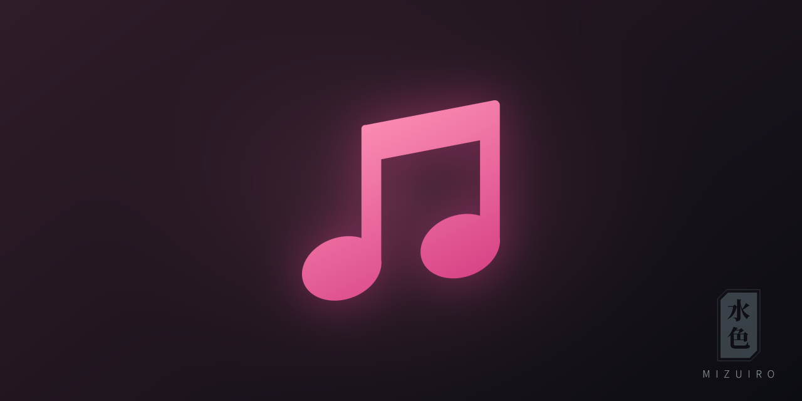
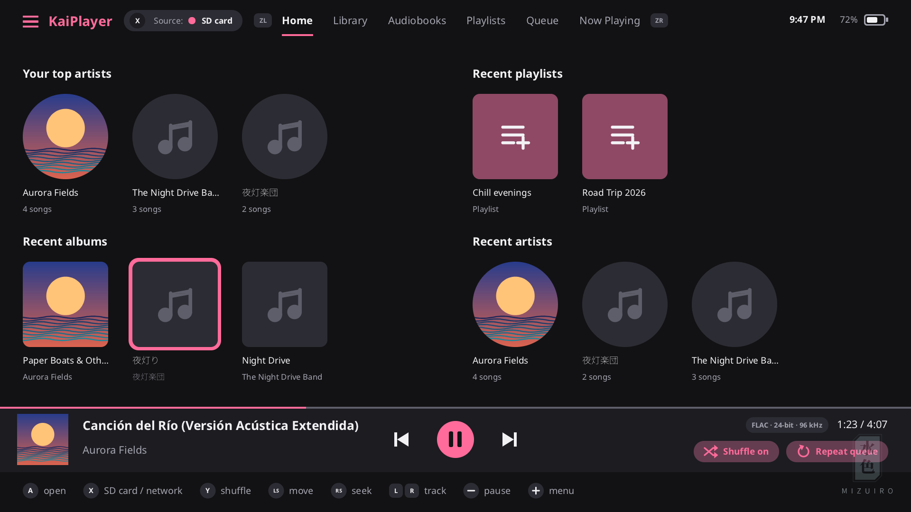
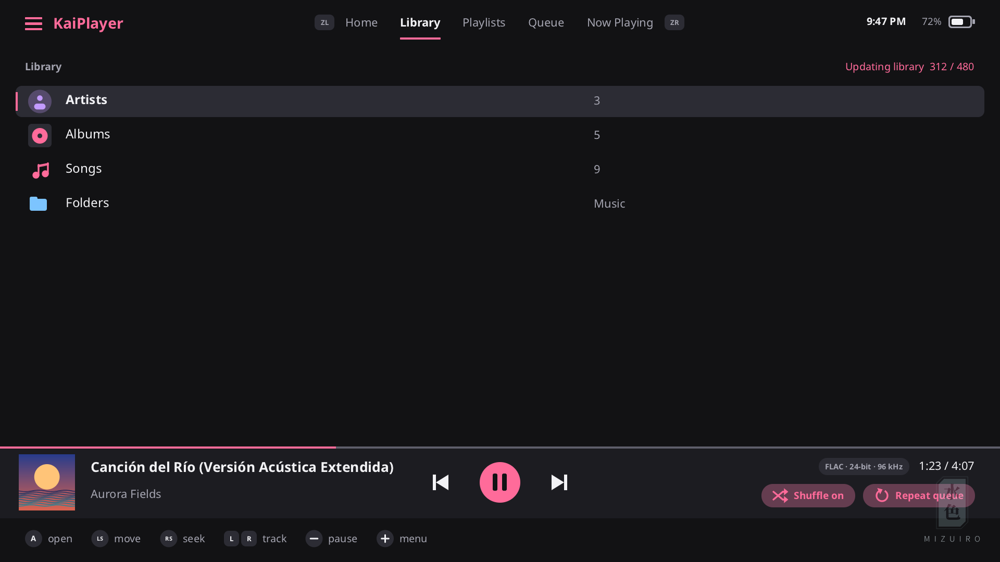
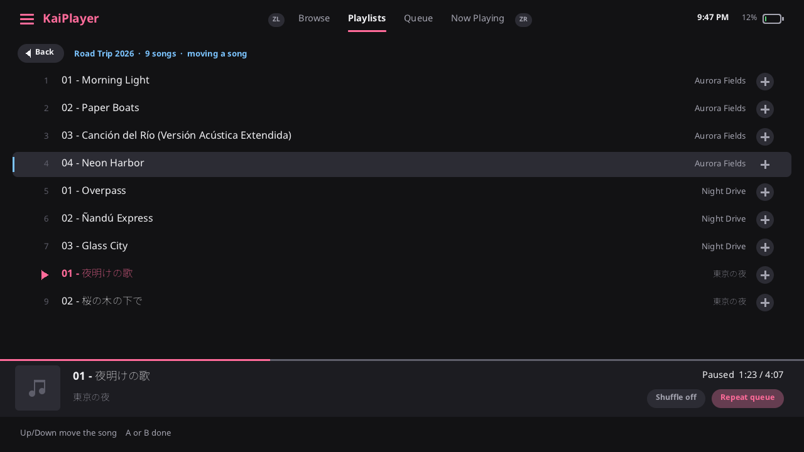
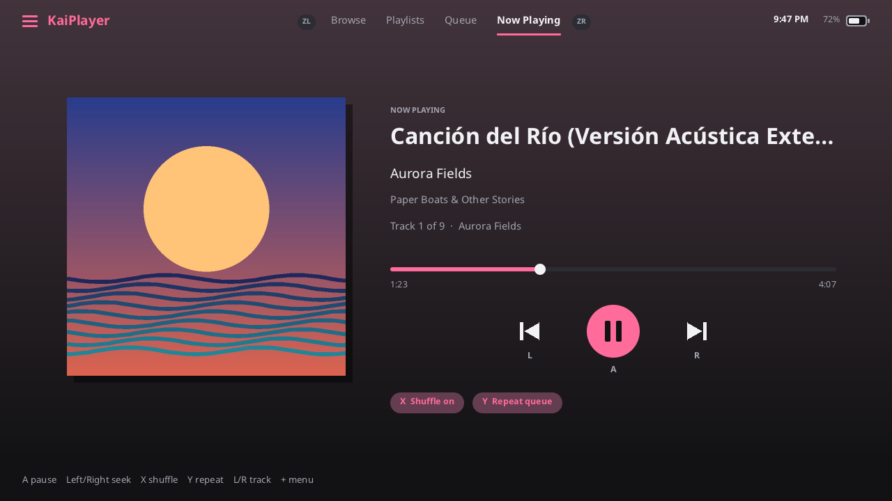
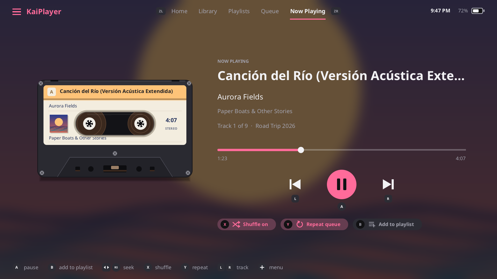
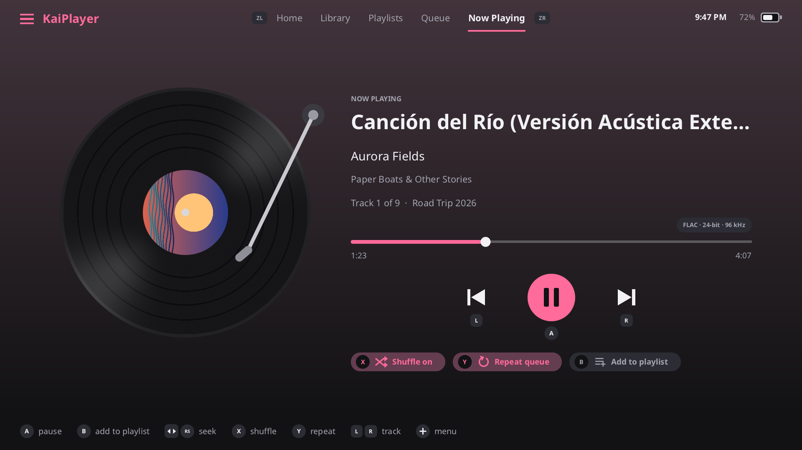
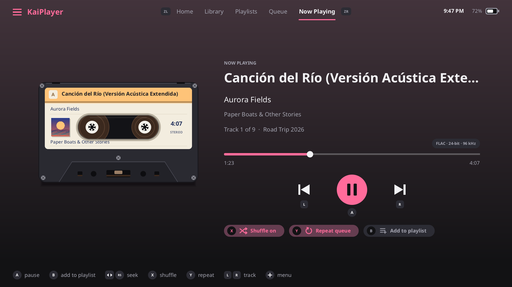

# KaiPlayer

An **open-source homebrew music player** for **Switch 2** running
[kaiHEN](https://github.com/ouncebrew/kaihen). Pick a folder on your microSD
card and KaiPlayer builds a library of your artists, albums and songs from
their tags. It plays MP3, FLAC, AAC, ALAC, Opus, Ogg Vorbis, WAV and DSD,
with nothing else to install.

| Home | Library | Playlists |
|------|---------|-----------|
|  |  |  |

| Queue | Now Playing | A background picture |
|-------|-------------|----------------------|
|  |  |  |

| Vinyl record | CD | Cassette |
|--------------|----|----------|
|  |  |  |

> KaiPlayer is an independent project. It is not affiliated with, endorsed by
> or sponsored by Nintendo. See the [legal notice](docs/legal.md).

## What it can do

- **A library from your tags:** artists, albums, songs and folders. Home shows
  your top artists, recent albums, playlists and artists, with their covers.
  [More](docs/library.md)
- **MP3, FLAC, AAC, ALAC, Opus, Ogg Vorbis, WAV and DSD** (`.m4a`, `.mp4`,
  `.aac` and `.opus` with FFmpeg; `.dsf`, `.dff` converted to PCM),
  at any sample rate. [More](docs/playback.md)
- **Music from your network:** a Windows shared folder, a NAS or Samba
  (SMB), or WebDAV, as a library of its own. [More](docs/network-folder.md)
- **Music from a Navidrome server** (or any Subsonic server): its library,
  covers and play counts, playing the original files. [More](docs/navidrome.md)
- **Audiobooks** in a tab of their own: `.m4b` and folders of files, their
  chapters, each book going on where you left it, 30-second skips, 0.75x to 2x
  with the voice's pitch kept, and a sleep timer to the chapter's end; from the
  card, the network folder or Navidrome. [More](docs/audiobooks.md)
- **Covers** embedded in the file, or a `cover.jpg` (or similar) in the
  album's folder. [More](docs/library.md#song-details-and-album-art)
- **Titles in any language** from the tags, including Japanese, Chinese and
  Korean. [More](docs/file-names.md)
- **Playlists** as standard `.m3u8` files in your music folder, with names in
  any language. [More](docs/playlists.md)
- **Queue, shuffle, repeat**, and it resumes where you left off.
  [More](docs/playback.md#queue-shuffle-and-repeat)
- **Now Playing as a cover, a turning record, a CD or a cassette**, and a
  picture of yours behind every view. [More](docs/settings.md#now-playing-style)
- **Lyrics**: synced ones show the line being sung, plain ones scroll with the
  song. From a `.lrc` file next to the song, the song's own tags, or a Navidrome
  server. [More](docs/library.md#lyrics)
- **10-band equalizer, ReplayGain, sleep timer** and screen off while
  playing. [More](docs/settings.md)
- **Drawn with the GPU** at the screen's resolution: 1080p handheld, up to 4K
  docked. [More](docs/playback.md#screen-and-resolution)
- **In nine languages**: English, Spanish, French, Italian, Portuguese, German,
  Japanese, Chinese and Korean, and any other you add as a text file.
  [More](docs/languages.md)
- **Touch and buttons** for every control. Lists glide under your finger.
  [Controls](docs/controls.md)

## Install

You need a Switch 2 with **kaiHEN** running (launch a game while holding
**R** to open hbmenu), and OunceShell's FTP server with an FTP client such as
[FileZilla](https://filezilla-project.org/) on a PC on the same Wi-Fi. The
full steps are in [Installing](docs/install.md).

> **Don't take the microSD card out while kaiHEN is running.** Removing it
> means restarting the console, and kaiHEN has to be started again after
> that.

1. Download `KaiPlayer.nro` from the latest release on the
   **[Releases](../../releases)** page.
2. In hbmenu, open **OunceShell** and start its FTP server. It shows the
   console's address and port.
3. Connect to it from your PC, make a `kaiplayer` folder inside the `switch`
   folder and copy `KaiPlayer.nro` into it, so it is
   `sdmc:/switch/kaiplayer/KaiPlayer.nro`.
4. Copy your music to a folder on the card, for example `Music`.
5. Open hbmenu and select **KaiPlayer**. The first time, it asks where your
   music is: a folder on the SD card, a network folder, a Navidrome server, or
   later.

> **Use plain letters (A–Z, no accents) in file and folder names.** On
> Switch 2, names with accents (`á é ñ ü`), typographic quotes (`’`) or
> Japanese are hidden by the console's file system, in every app. Upload with
> [KaiDrop](https://github.com/mizuiroame/kaidrop) (work in progress), which
> gives the copies plain names, or rename the files first. KaiPlayer still
> shows the real names from the tags. See [File names and tags](docs/file-names.md).

## Documentation

- [Installing](docs/install.md): every step, updating, where KaiPlayer keeps
  its files
- [The library](docs/library.md): Home, Library, song details and album art
- [Network folder](docs/network-folder.md): music from a shared folder or
  WebDAV on your network
- [Navidrome](docs/navidrome.md): music from a Navidrome or Subsonic server
- [Playback](docs/playback.md): formats, DSD, queue, resume, screen
  resolution
- [Playlists](docs/playlists.md)
- [Controls](docs/controls.md): buttons, the + menu, touch screen
- [Settings](docs/settings.md): sleep timer, equalizer, ReplayGain, Now
  Playing styles, backgrounds
- [Languages](docs/languages.md): choosing one, and translating KaiPlayer
- [File names and tags](docs/file-names.md): non-ASCII names, KaiDrop and
  `kaiupload.py`
- [Troubleshooting](docs/troubleshooting.md)
- [Known limitations](docs/limitations.md)
- [Building](docs/building.md): building from source, releases, project
  layout
- [Security](docs/security.md), and [how to report a problem](SECURITY.md)
- [Legal notice and licenses](docs/legal.md)

## License

KaiPlayer is released under the [MIT License](LICENSE). Copyright (c) 2026
Mizuiro. It uses dr_libs, stb, FFmpeg and libsmb2 (both under the LGPL 2.1),
curl, zlib and the Noto Sans font; the full list is in
[docs/legal.md](docs/legal.md#licenses).
