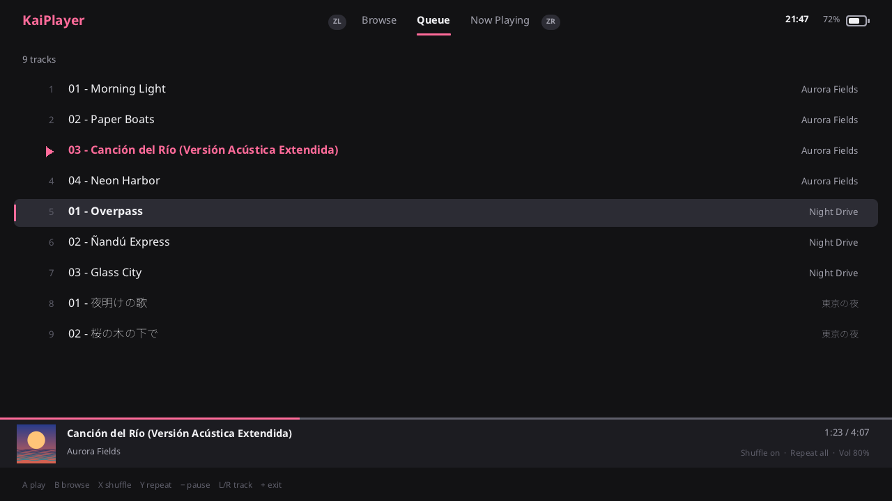

# KaiPlayer

An **open-source homebrew music player** for **Switch 2** running
[kaiHEN](https://github.com/ouncebrew/kaihen). Pick a folder on your microSD
card and KaiPlayer plays the music in it.


| Browse | Queue |
|--------|-------|
|  |  |

> KaiPlayer is an independent project. It is not affiliated with, endorsed by
> or sponsored by Nintendo. See the [Legal notice](#legal-notice).

- [For users: install the .nro](#for-users-install-the-nro)
- [Supported audio formats](#supported-audio-formats)
- [Controls](#controls)
- [For developers: build from source](#for-developers-build-from-source)
- [Legal notice](#legal-notice)
- [License](#license)

---

## For users: install the .nro

You don't need to build anything.

### Requirements

- A Switch 2 with **kaiHEN** running. Launch a game while holding **R** to open
  the homebrew menu (hbmenu).
- A microSD card with your music on it.

### 1. Download

Go to the repository's **[Releases](../../releases)** page and download
`KaiPlayer.nro` from the latest release.

### 2. Copy the .nro to the console

Choose one of these methods.

**A. With the microSD card in your PC**

1. Turn off the console and remove the microSD card.
2. Copy `KaiPlayer.nro` into the card's `switch/` folder, so that its path is
   `sdmc:/switch/KaiPlayer.nro`. Create the folder if it doesn't exist.
3. Put the card back in the console.

**B. Over FTP, without removing the card**

1. In hbmenu, open **OunceShell** (it comes with kaiHEN) and start its FTP
   server. OunceShell shows the console's IP address and port.
2. On your PC, connect to that address and port with an FTP client such as
   FileZilla.
3. Upload `KaiPlayer.nro` to `/switch/`.

**C. With nxlink (optional)**

If your hbmenu has its *netloader* enabled (**Y** button in hbmenu), you can
send the file straight from your PC:

```sh
nxlink -a <console-IP> KaiPlayer.nro
```

`nxlink` comes with devkitPro. This runs the program once without installing
it.

### 3. Copy your music

Put your audio files in any folder on the microSD card, for example
`sdmc:/Music/`. Subfolders (artist, album, and so on) are fine. Copy them the
same way as the `.nro`: with the card in your PC, or over FTP.

### 4. Play it

1. Open hbmenu (launch a game while holding **R**) and select **KaiPlayer**.
2. Use the D-pad to go to your music folder.
3. Press **X** to play the whole folder, subfolders included. Or press **A**
   on a song to start from that song.

KaiPlayer remembers the last folder, the volume, and the shuffle and repeat
modes. It saves them in `sdmc:/config/kaiplayer/settings.txt`.

---

## Supported audio formats

All of these formats are **open and royalty-free**. The decoders are built into
the `.nro`, so you don't need to install anything else.

| Format         | Extensions     | Notes                                                 |
|----------------|----------------|-------------------------------------------------------|
| **MP3**        | `.mp3`         | CBR and VBR. The MP3 patents expired in 2017.         |
| **FLAC**       | `.flac`        | Lossless, 8 to 32 bits.                               |
| **Ogg Vorbis** | `.ogg`, `.oga` | Vorbis only. `.ogg` files that contain Opus don't play. |
| **WAV**        | `.wav`         | PCM, IEEE float, A-law and µ-law.                     |

- **Sample rates:** any sample rate works (44.1 kHz, 48 kHz, 96 kHz and so on).
  KaiPlayer converts it to the console's 48 kHz.
- **Channels:** mono is played on both channels. For files with more than two
  channels, KaiPlayer plays the front left and front right channels.

**Not supported yet:** Opus, AAC/M4A, ALAC, WMA and DRM-protected files. AAC
and WMA won't be added, because they need paid licenses.

---

## Controls

KaiPlayer has three tabs: **Browse**, **Queue** and **Now Playing**. Press
**ZL** / **ZR** to move between them. When you start playing music, KaiPlayer
switches to Now Playing.

| Button    | Browse                          | Queue                   | Now Playing                |
|-----------|---------------------------------|-------------------------|----------------------------|
| ↑ ↓ / LS  | Move                            | Move                    | Volume up / down           |
| ← →       | Previous / next page            | Previous / next page    | Rewind / fast-forward 10 s |
| A         | Open folder / play from song    | Play this track         | Pause / resume             |
| B         | Go up one folder                | Back to Browse          | Back to Browse             |
| X         | Play the whole folder           | Shuffle on / off        | Shuffle on / off           |
| Y         | Shuffle the whole folder        | Repeat: off / all / one | Repeat: off / all / one    |

In every tab:

| Button  | Action |
|---------|--------|
| ZL / ZR | Previous / next tab |
| L / R   | Previous / next track |
| −       | Pause / resume |
| RS ← →  | Rewind / fast-forward 10 s |
| +       | Exit |

The console's own volume buttons also work. The top right corner shows the
time and the battery level (green while charging, red at 15% or less).

**X** and **Y** also play the subfolders. When you press them in the root of
the card, KaiPlayer skips the system and homebrew folders there (`switch`,
`config`, `Nintendo`, `atmosphere`, kaiHEN's folders and so on), so their
sound effects don't end up in the queue. The queue shows the folder each
track comes from.

If a song has played for more than 3 seconds, **L** restarts it. Otherwise
**L** goes to the previous song.

### Album art and song details

Now Playing shows the album cover, title, artist and album. KaiPlayer reads
them from the file's tags:

| Format     | Tags read |
|------------|-----------|
| MP3        | ID3v2.2, v2.3 and v2.4 (title, artist, album, cover); ID3v1 as a fallback |
| FLAC       | Vorbis comments and the embedded picture |
| Ogg Vorbis | Vorbis comments and the embedded picture (`METADATA_BLOCK_PICTURE`) |
| WAV        | None: the file name is shown |

If a file has no embedded cover, KaiPlayer looks for `cover.jpg`,
`folder.jpg`, `front.jpg`, `albumart.jpg`, `cover.png`, `folder.png` or
`front.png` in the same folder. Covers can be JPEG or PNG, up to 4096×4096
pixels and 8 MB.

### Troubleshooting

| Problem | Solution |
|---------|----------|
| "No music in this folder" | Check that the files have one of the extensions in the formats table. |
| "Could not open: file" | The file is damaged, or it isn't in the format its extension says. KaiPlayer skips it. |
| An MP3's length shows as `--:--` | That MP3 has no Xing/Info header. It plays normally, only without a length. |
| `?` in names | Latin, Greek and Cyrillic use KaiPlayer's own font. Japanese, Chinese and Korean use the console's built-in fonts; if the console doesn't provide them, those characters show as `?`. |
| "Some items in this folder could not be read" | The console reported an error while listing the folder, so some files may be missing from the list. See the next row. |
| A file doesn't appear | Check that it has a supported extension. If its name has non-Latin characters (for example Japanese) and you copied it over FTP, check FileZilla's transfer log for errors, then try copying it with the microSD card in your PC. If it shows up after renaming it to a plain name such as `test.flac`, please open an issue with the original name. |
| No cover | The file has no embedded cover and there is no `cover.jpg` (or similar) in its folder, or the image is larger than 4096×4096 or 8 MB. |
| "Audio unavailable" | The console's audio service could not start. Restart and open KaiPlayer again. If it keeps happening, open an issue. |

---

## For developers: build from source

KaiPlayer is built with [ounce-devkit](https://github.com/ouncebrew/ounce-devkit),
which is devkitPro plus libounce, a libnx for Switch 2. Docker is the easiest
way to build it.

### With Docker (Windows, Linux, macOS)

1. Build the devkit image. You only need to do this once:

   ```sh
   git -c core.autocrlf=false clone https://github.com/ouncebrew/ounce-devkit
   cd ounce-devkit
   docker build -t ounce-devkit .
   ```

   > On Windows you must clone with `core.autocrlf=false`. Otherwise the
   > scripts get CRLF line endings and `install.sh` fails inside the image.

2. Build KaiPlayer.

   On Windows (PowerShell):

   ```powershell
   .\build.ps1           # builds KaiPlayer.nro
   .\build.ps1 test      # host tests (ASan/UBSan + coverage)
   .\build.ps1 fuzz      # fuzzes every file parser ($env:ITER sets the count)
   .\build.ps1 preview   # renders UI screenshots, no console needed
   .\build.ps1 clean
   ```

   On Linux or macOS:

   ```sh
   docker run --rm -v "$PWD:/build/kaiplayer" -w /build/kaiplayer ounce-devkit make
   docker run --rm --security-opt seccomp=unconfined \
     -v "$PWD:/build/kaiplayer" -w /build/kaiplayer/tests ounce-devkit make coverage
   docker run --rm --security-opt seccomp=unconfined \
     -v "$PWD:/build/kaiplayer" -w /build/kaiplayer/tests ounce-devkit make fuzz ITER=3000
   docker run --rm -v "$PWD:/build/kaiplayer" -w /build/kaiplayer/tests/preview ounce-devkit make
   ```

The output is `KaiPlayer.nro`, in the project root.

`preview` compiles the real interface code on the host with a fake player
and writes `tests/preview/build/*.ppm` screenshots of each tab.

The tests and the fuzzer run with ASLR turned off (`setarch -R`), because GCC 12's
AddressSanitizer can hang on recent kernels. In Docker, turning ASLR off needs
`--security-opt seccomp=unconfined`.

### Without Docker

Install [devkitPro pacman](https://devkitpro.org/wiki/devkitPro_pacman), then
run `sh install.sh` inside `ounce-devkit/`. After that, in this folder, run:

```sh
make                 # KaiPlayer.nro
make -C tests run    # tests (needs the system gcc)
```

### Making a release

1. Bump `APP_VERSION` in the `Makefile`.
2. Run `.\build.ps1 clean`, then `.\build.ps1`.
3. Tag the release (`git tag v1.0.0 && git push --tags`).
4. Create the GitHub release and attach `KaiPlayer.nro`.

### Project layout

```
source/
  main.c          main loop and controls
  player.c        audio thread: decode → resample → audout
  decoder.c       common interface for MP3 / FLAC / Vorbis / WAV
  resampler.c     sample rate conversion (linear interpolation)
  queue.c         play order, shuffle and repeat
  library.c       finds the music in a folder (recursively)
  browser.c       folder browser
  tags_*.c        ID3 and Vorbis comment readers (title, artist, album, cover)
  cover.c         decodes and scales album art (JPEG / PNG)
  artwork.c       loads tags and covers on a background thread
  gfx.c           drawing: shapes, gradients, images
  gfx_switch.c    the console framebuffer
  font.c          anti-aliased text with the embedded fonts
  ui*.c           the Browse, Queue and Now Playing tabs
  config.c        settings saved on the SD card
  input.c         button auto-repeat
data/           Noto Sans Regular and Bold, embedded in the .nro
third_party/    dr_libs, stb_vorbis, stb_image, stb_truetype (public domain)
tests/          host tests, fuzzer, fixtures and the UI preview
icon.jpg        256×256 icon for hbmenu
```

### Known limitations

- Rewinding in a very long MP3 can take a moment, because dr_mp3 decodes again
  from the start of the file.
- Pause and track changes have about 140 ms of latency, the size of the audio
  buffers.
- A play list holds up to 8192 tracks, from up to 8 levels of subfolders.

---

## Security

Under kaiHEN, homebrew runs with broad system access. A bug in an app that
reads untrusted files could therefore affect the whole console. KaiPlayer
reduces that risk in these ways:

- **Small attack surface.** No network access. The app only reads the files
  and folders you browse, and only writes
  `sdmc:/config/kaiplayer/settings.txt`.
- **Untrusted input is bounded.**
  - Paths and settings use length-checked buffers.
  - Audio headers with unsupported channel counts (0 or more than 8) or sample
    rates (below 1 kHz or above 768 kHz) are rejected.
  - Folder listings and recursive scans have entry, depth and track limits.
- **Images are checked before decoding.** Only JPEG and PNG are decoded, and
  images over 4096×4096 pixels or 8 MB are refused before any memory is
  allocated for them. The tag readers check every length against the data.
- **Hardening.** The `.nro` is built with `-fstack-protector-strong` and
  `-fwrapv` (signed overflow wraps instead of being undefined). The host
  tests run under AddressSanitizer and UndefinedBehaviorSanitizer.
- **Fuzzing.** `make -C tests fuzz` feeds thousands of corrupted MP3, FLAC,
  Ogg, WAV, JPEG and PNG files to every parser, with the sanitizers on. Run it
  before each release.
- **Pinned dependencies.** The libraries in `third_party/` and the fonts in
  `data/` are pinned to upstream commits with SHA-256 sums. See
  [third_party/VERSIONS.md](third_party/VERSIONS.md), and check them with
  `sh third_party/verify.sh`.

The main remaining risk is in the third-party decoders, which parse files from
the SD card. Only play files from sources you trust.

To report a vulnerability, please open a private security advisory on GitHub
instead of a public issue.

---

## Legal notice

- **Independent project.** KaiPlayer is not affiliated with, endorsed by or
  sponsored by Nintendo Co., Ltd. or its subsidiaries.
- **Trademarks.** "Nintendo", "Nintendo Switch" and "Switch 2" are trademarks
  of their owners. They are used here only to say which hardware this program
  works with.
- **No Nintendo material.** This repository and its releases contain no
  Nintendo code, SDK, firmware, cryptographic keys, games, or graphics or audio
  assets. KaiPlayer is built only with open-source tools and libraries.
- **No circumvention.** KaiPlayer does not circumvent any technical protection
  measure, and it can't be used to copy or run commercial software. It plays
  the audio files that users put on their own card.
- **User responsibility.** Only play music you have the right to listen to.
  Running homebrew (kaiHEN) can put your console at risk, can affect its
  warranty and can go against the manufacturer's terms of service. You do it at
  your own risk.
- **No warranty.** The software is provided "as is", without warranty of any
  kind. See [LICENSE](LICENSE).

This notice is not legal advice.

---

## License

KaiPlayer is released under the [MIT License](LICENSE), which also contains
the legal notice above.

Copyright (c) 2026 Mizuiro.

Third-party libraries in `third_party/`:

| Library | Used for | License |
|---------|----------|---------|
| [dr_mp3, dr_flac, dr_wav](https://github.com/mackron/dr_libs) | Decoding MP3, FLAC and WAV | Public domain (Unlicense) or MIT-0 |
| [stb_vorbis](https://github.com/nothings/stb) | Decoding Ogg Vorbis | Public domain or MIT |
| [stb_image](https://github.com/nothings/stb) | Decoding album art (JPEG, PNG) | Public domain or MIT |
| [stb_truetype](https://github.com/nothings/stb) | Drawing text | Public domain or MIT |
| [Noto Sans](https://github.com/notofonts/latin-greek-cyrillic) (`data/`) | Interface font | SIL Open Font License 1.1 ([third_party/NotoSans-OFL.txt](third_party/NotoSans-OFL.txt)) |

The `.nro` also links [libounce](https://github.com/ouncebrew/libounce), which
uses the ISC license (its bundled mimalloc uses MIT).
