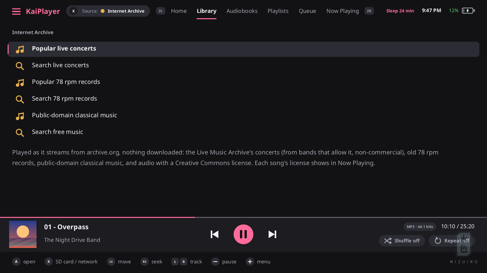
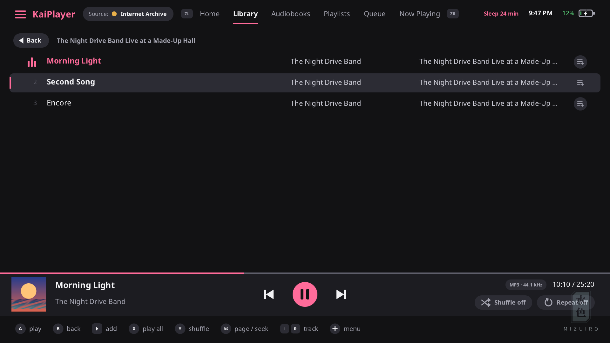
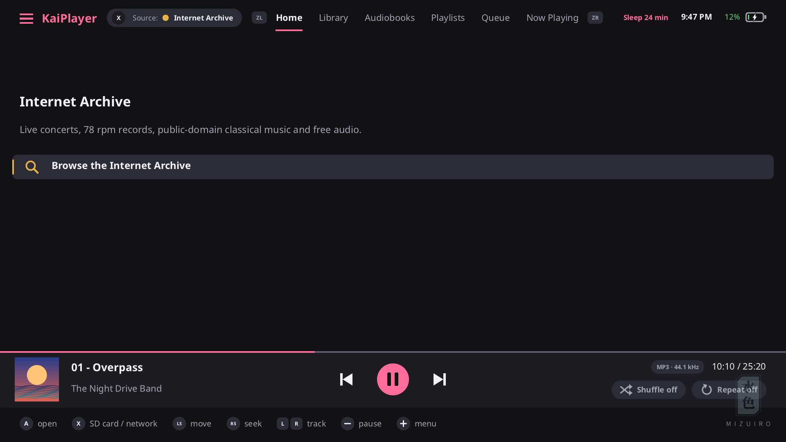
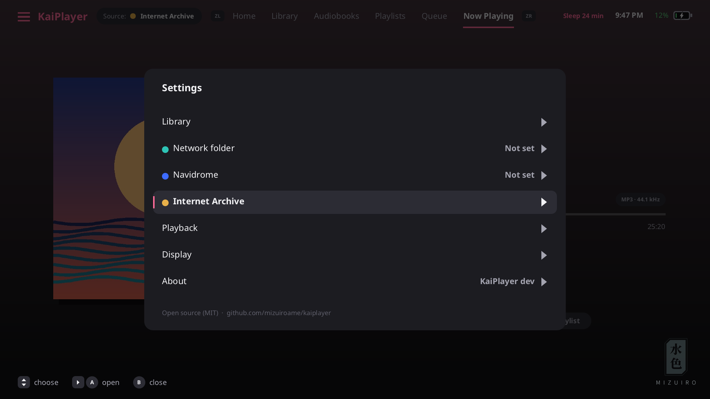
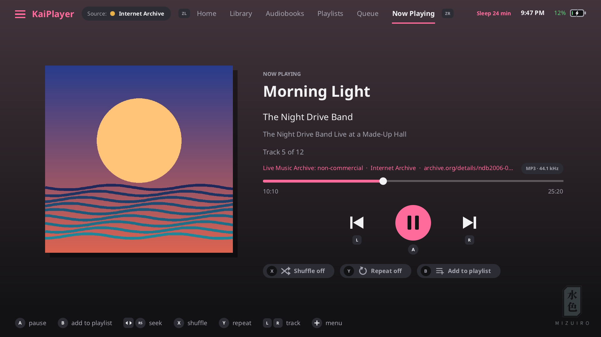

# Internet Archive

[Back to the README](../README.md)

KaiPlayer can play music from the [Internet Archive](https://archive.org)
(archive.org) as it streams. It's a source of its own, next to the SD card, a
network folder and a Navidrome server, and it needs nothing set up: no
account and no key. The Archive is best for:

- **Live concerts** from the Live Music Archive (`etree`): hundreds of
  thousands of recordings by bands that allow their shows to be taped and
  shared for non-commercial use.
- **78 rpm records**: old shellac recordings, transferred by the Archive's
  78 rpm collection.
- **Public-domain classical music**.
- **Free music**: any audio with a declared Creative Commons license.

| Its first page | A concert's songs |
|----------------|-------------------|
|  |  |

| Home while it's the source | Its place in Settings |
|----------------------------|-----------------------|
|  |  |

## Going to it

As with the other sources: **X** on Home or on Library's first page, a tap on
the pill next to KaiPlayer's name, or **+ → Go to the Internet Archive**. The
pill then says **Internet Archive**, with its amber dot (another color can be
chosen in **+ → Settings → Internet Archive → Color**). The same ways go on to
the next source: **SD card**, **network folder**, **Navidrome** (those set
up), **Internet Archive**, then the SD card again.

The Archive is far too big to read whole as a library, so it isn't read into
Artists, Albums and Songs: it's browsed, a page at a time. While it's the
source:

| Tab | What it shows |
|-----|---------------|
| **Home** | What the Archive has, and **Browse the Internet Archive**, which opens Library (**A**, or a tap) |
| **Library** | The Archive's own first page (below), instead of Artists, Albums, Songs and Folders |
| **Audiobooks** | Your audiobooks, as with any source (they aren't the Archive's) |
| **Playlists**, **Queue**, **Now Playing** | As always: playlists can mix the Archive's songs with the others' |

The other sources' libraries aren't shown while the Archive is, and the
Archive doesn't show inside them. **+ → Update the library** isn't offered for
it: each page asks the Archive when it opens.

## Its pages

Library's first page has:

| Row | What it shows |
|-----|---------------|
| **Popular live concerts** | The Live Music Archive's most downloaded concerts |
| **Search live concerts** | Concerts whose band, place or date match the words you type |
| **Popular 78 rpm records** | The 78 rpm collection's most downloaded records |
| **Search 78 rpm records** | Records whose title or artist match your words |
| **Public-domain classical music** | The most downloaded classical recordings marked public domain |
| **Search free music** | Any audio with a Creative Commons license that matches your words |

Each list shows 50 items (a concert, a record, an album), with its cover, its
artist and its date; when the Archive has more, **Show 50 more** at the end
adds the next 50 (up to 500). **A** on an item opens its songs; **A** on a
song plays the item from there, **X** plays it all and **Y** shuffles it.
**→** or the small plus at a song's end adds it to a playlist, and **B** (or
**< Back**) goes back. Everything works by touch too: tap a row to open or
play it, tap **< Back**, tap the plus.

While a page is asked for it says **Asking...**. If the Archive doesn't
answer, the page says why, and its **Try again** row asks again.

A song plays as a song from the card does: in the queue, with Now Playing's
styles, the equalizer and ReplayGain. It's read a little ahead as it plays;
nothing is downloaded to the card.

## Licenses and credits

Every song from the Archive shows where it comes from and under what terms:

- **Now Playing** has a line under the track number, such as
  `CC BY-SA 4.0 · Internet Archive · archive.org/details/<item>`, or
  `Live Music Archive: non-commercial · Internet Archive · …` for a concert.
- **+ → About this song** (in Now Playing, or on a song in an Archive page)
  shows the artist, the license, where its text is
  (`creativecommons.org/licenses/…`) and the item's page on archive.org.

The license is the one the item declares on the Archive. The Live Music
Archive's concerts have none: their bands allow non-commercial sharing. Records
from the 78 rpm collection without one say **78 rpm collection**. The Archive
itself says it rarely makes these declarations: they come from whoever
uploaded the item.

## In playlists and the queue

Playlists can hold the Archive's songs, as `ia:/<item>/<license>/<file>`
lines in the `.m3u8` (other players won't play them). They play whichever
source is shown, whenever the console's network is up. The queue is restored
after a restart too: once you have used the Internet Archive, KaiPlayer starts
the network when it starts.

The song lists name the songs as the Archive's pages do. After KaiPlayer is
restarted, a playlist's Archive songs are named from their files' own tags
(the Archive's MP3s have them).

## Good to know

- **Only what has a clear permission** is searched: the Live Music Archive,
  the 78 rpm collection, and audio with a Creative Commons or public-domain
  license. Other uploads aren't offered.
- **No downloads** to the card: songs are read as they play.
- **One format per item**: its MP3s (VBR, else 128 or 64 kbps), else Ogg
  Vorbis, else FLAC. Up to 500 songs an item.
- **50 items at a time**, up to 500 with **Show 50 more**; the most
  downloaded first (searches: the best match first).
- **The Archive can be slow** to answer at times. If it's busy, wait a
  minute: KaiPlayer asks only when you open a page.
- KaiPlayer isn't affiliated with the Internet Archive.
