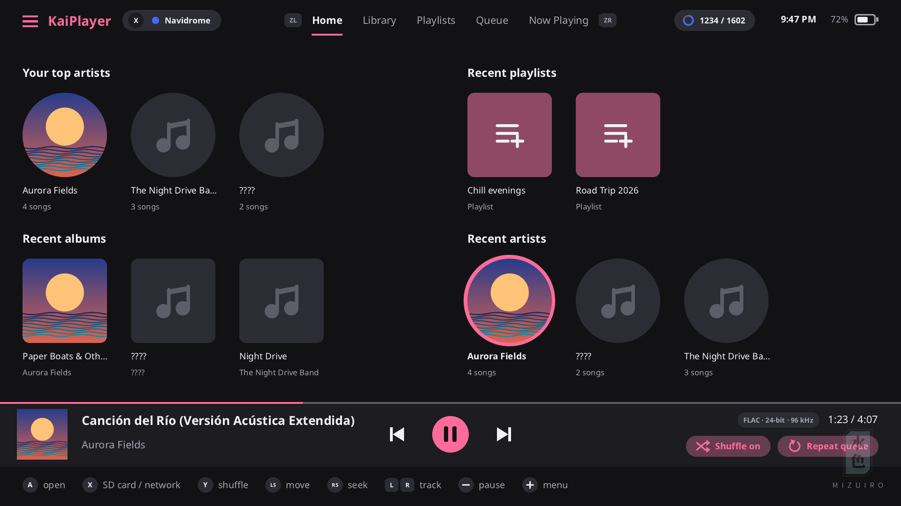
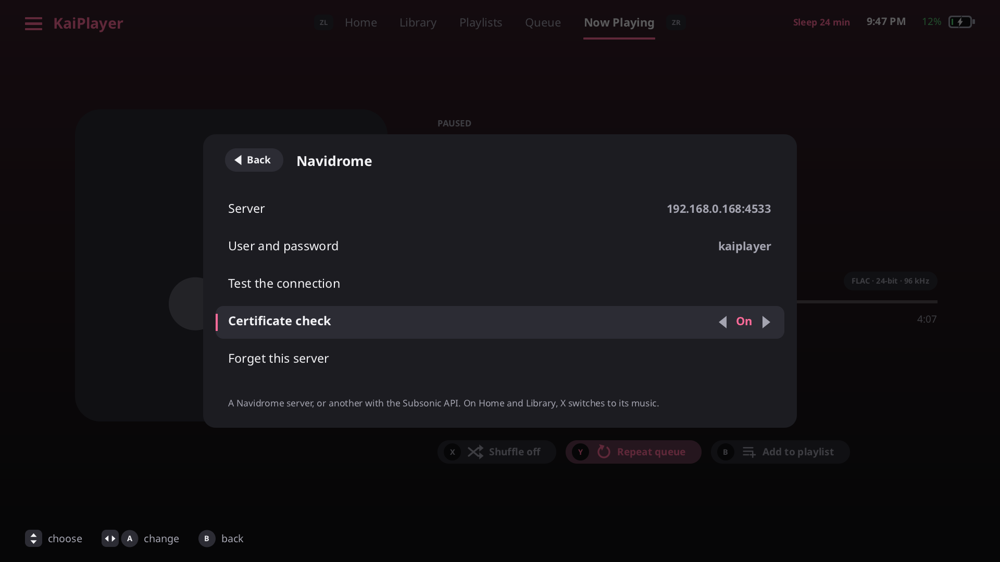

# Navidrome

[Back to the README](../README.md)

KaiPlayer can play your music from a **Navidrome** server, or any other
server with the Subsonic API (Airsonic, Gonic, Ampache's Subsonic API...).
The library comes from the server, so nothing is read from the songs to list
them: a library of thousands of songs shows in a few seconds. Songs play from
the original files, and covers come from the server.

| As the library | Its Settings page |
|----------------|-------------------|
|  |  |

## Setting it up

In **+ → Settings → Navidrome**:

1. **Server**: the server's address and port, like `192.168.0.10:4533`
   (Navidrome's port is usually 4533), or a full `https://` address, with its
   path if the server is behind one (`https://music.example.com/navidrome`).
   Navidrome's own page, copied from a browser, works too.
2. **User and password**: your account on the server. KaiPlayer signs in at
   once and says whether it worked.
3. **Test the connection**: it says which server answered, its version, and
   how many songs it has, or what went wrong.
4. **Certificate check**: for an `https://` server with its own certificate
   (not one a browser trusts), turn it **Off**.

Then the pill next to KaiPlayer's name says **Navidrome**, with a blue dot,
when its library is shown. **X** on **Home** or on **Library's first page**,
a tap on the pill, or **+ → Go to the … library** goes to the next library
that is set up:
**SD card**, **Network folder**, **Navidrome**, then the SD card again.

- **Artists, Albums and Songs** come from the server. KaiPlayer reads them as
  soon as you sign in, and its library becomes the one shown; each time
  KaiPlayer starts, it reads it again in the background, even while another
  library is shown. A blue pill at the top right shows the songs
  read so far; tap it to see that library. After the first time, the library
  shows at once from what was kept on the card (`catalog-subsonic.txt`).
- **Folders** has nothing to show for a server: its songs are in Artists,
  Albums and Songs.
- **Covers** are the album covers the server has.
- **Playing** reads the original file (`download`), a little ahead, as for the
  network folder. If the server doesn't let its songs be downloaded, KaiPlayer
  asks for them as they are (`stream`, unconverted). ReplayGain from the songs'
  tags works as for songs on the card.
- **Plays are told to the server** (scrobbling): "now playing" when a song
  starts, and played after half of it (or four minutes). Navidrome's play
  counts and "Recently played" stay right, and so do Last.fm or ListenBrainz
  if the server sends plays there.
- **Playlists** of yours can hold songs from the server; they play when the
  server is set up. The server's own playlists aren't shown.

A new server address forgets the old sign-in, so it's never sent to another
server. **Forget this server** removes the address and the sign-in, and the
library goes back to the card.

## Good to know

- **The password isn't kept, but the token works like it.** KaiPlayer keeps
  only what Subsonic's sign-in needs: a random salt and the MD5 of the
  password with it (the "token"), in `navidrome.txt` in KaiPlayer's folder,
  on the SD card and not encrypted. The password itself is never sent: each
  request carries the user, the salt and the token. Whoever has that file can
  use the account through the Subsonic API (play, download, change its
  playlists) until you change the password on the server, so use an account
  that only plays music.
- **Over plain `http://`** the token travels unencrypted. Use it on your home
  network, or use `https://`.
- **A server that doesn't take tokens** (some that sign in with LDAP, for
  example) says so when you test it: KaiPlayer doesn't send passwords.
- **Formats**: songs KaiPlayer plays (MP3, FLAC, AAC, ALAC, Opus, Ogg Vorbis,
  WAV, DSD) are listed; others (WMA, WavPack...) are left out of the library.
  Songs play as they are on the server, never converted by it.
- **Ogg Vorbis** songs are read whole before they play (they're small);
  Opus songs, in `.opus` or `.ogg` files, play as they come, like the others.
- **If the server stops answering**, the song stops after about 20 seconds,
  and KaiPlayer stops trying after three songs in a row can't be opened.
- **Large libraries**: a server's library is read 500 songs at a time; up to
  200,000 songs.
- The console's network is only started when there is a server (or a network
  folder).
- Tried with Navidrome 0.64 on a home network.

## For servers other than Navidrome

KaiPlayer asks for the whole library with `search3` and no words, as most
Subsonic clients that keep a library do. A server that finds nothing that way
is read album by album (`getAlbumList2`, then `getAlbum`), which takes longer.
