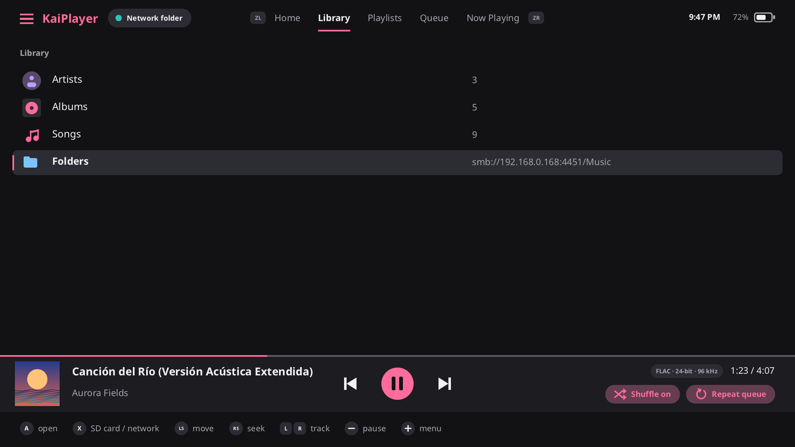
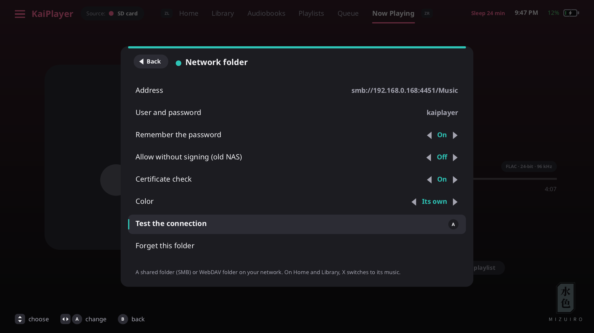

# Network folder

[Back to the README](../README.md)

KaiPlayer can play your music from a folder on your network, with nothing to
install on it:

- a **Windows shared folder**;
- a **NAS** (Synology, QNAP and the like);
- **Samba** on Linux or macOS;
- a **WebDAV** server (Nextcloud, rclone, a NAS's WebDAV).

| As the library | Its Settings page |
|----------------|-------------------|
|  |  |

## Setting it up

In **+ → Settings → Network folder**:

1. **Address**: one of these.
   - `\\PC\Music` or `smb://PC/Music` for a shared folder (SMB). A folder
     inside it works too: `\\PC\Music\Albums`. Use the computer's IP address
     (`\\192.168.0.10\Music`) if its name isn't found. For another port:
     `smb://PC:4450/Music`.
   - `192.168.0.10:8098/music`, or a full `http://` or `https://` address,
     for WebDAV.
2. **User and password**: the account that can read the folder. For a domain,
   type `DOMAIN\user`. With no user, the folder's guest access is used.
3. **Test the connection**: it says how many folders and songs are at the
   top, or what went wrong.

Then the pill next to KaiPlayer's name, at the top of every tab, says which
library is shown: **SD card**, or **Network folder** with a turquoise dot
(or **Navidrome** with a blue one, with a [Navidrome server](navidrome.md)
set up too: **X** goes through them in turn). To switch:

- press **X** on **Home** or on **Library's first page** (the pill shows the
  **X** there, and so does the help line);
- tap the pill, on any tab;
- or choose **+ → Go to the network folder library** (**Go to the SD card
  library** to go back).

With a network folder set up, **X** on Home switches the library instead of
playing the selected card: **A** opens the card, and you play it from there
(**Y** still shuffles it).

- **Artists, Albums and Songs** come from the songs' tags, read over the
  network and kept on the card. As soon as the folder is set up, its
  library is the one shown and KaiPlayer starts reading it; each time it
  starts, it looks for changes in the background, even while the card's
  library is shown. A pill at the top right
  shows the songs read so far (`1234 / 1602`); tap it to see that library.
  After the first time, only new or changed songs are read again, and the
  library shows at once.
- **Folders** browses the network folder, folder by folder.
- **X** again goes back to the card's music folder. Each keeps its own
  library.

A new address forgets the old user and password, so they're never sent to
another computer. **Forget this folder** removes the address, user and
password, and the library goes back to the card.

## Sharing a folder on Windows

1. **Make your network private**: Settings > Network & internet > Ethernet
   (or Wi-Fi) > Network profile type > **Private**. On a public network,
   Windows doesn't share folders.
2. **Share the folder**: right-click it > Properties > Sharing > **Advanced
   Sharing** > check **Share this folder** and give it a name, for example
   `Music`. Under **Permissions**, give your user **Read** only: KaiPlayer
   only reads.
3. On the console, type `\\<your PC's IP address>\Music` and your Windows
   user name and password. With a Microsoft account, use its e-mail address
   and password, not the PIN. If that fails, try
   `MicrosoftAccount\you@example.com`.

If **Test the connection** says nothing answered, check that **File and
Printer Sharing** is allowed in Windows Firewall for private networks.

## Good to know

- **Playing** reads each song a little ahead (about 30 seconds of FLAC), so a
  short pause on the network isn't heard. Changing songs waits for the next
  one's first piece: a moment on a home network.
- **Ogg Vorbis** songs are read whole before they play (they're small);
  Opus songs, in `.opus` or `.ogg` files, play as they come, like the others.
- **If the server stops answering**, the song stops after about 20 seconds,
  and KaiPlayer stops trying after three songs in a row can't be opened.
  Pressing next or previous doesn't wait for it.
- **The password** is kept on the card, in `network.txt` in KaiPlayer's
  folder, as it was typed: KaiPlayer needs it to sign in each time. Use an
  account that can only read the folder.
- **WebDAV over plain `http://`** sends the password without encryption.
  Use it only on your home network, or use `https://`.
- **Opening a folder** in Folders waits for the server's answer. That's
  usually a moment, but it can take several seconds when the server doesn't
  answer.
- **Playlists** in your music folder on the card can hold songs from the
  network folder; they play when the network folder is set up.
- The console's network is only started when there is a network folder.
- Tried with a Samba server and an rclone WebDAV server on a home network.
