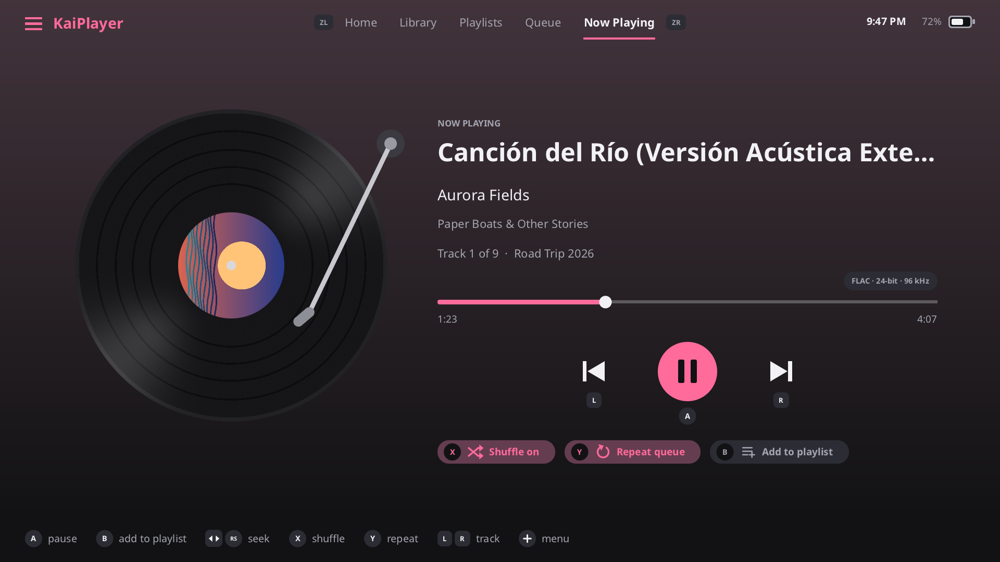
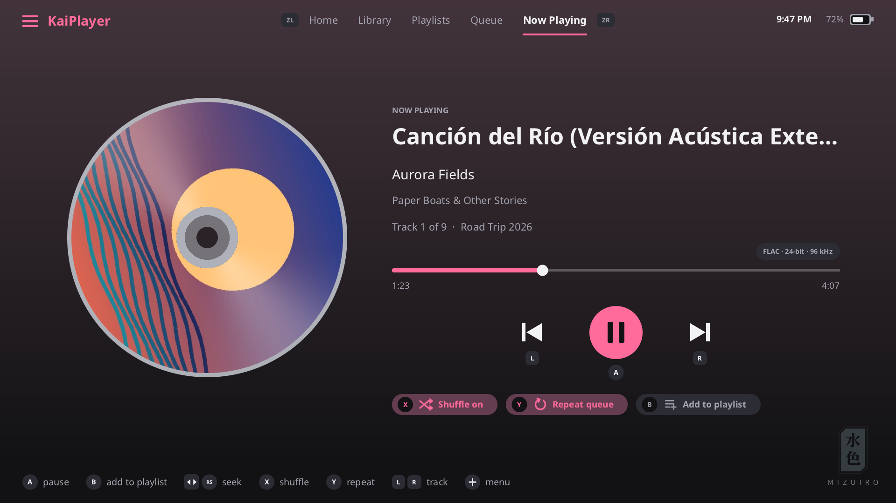
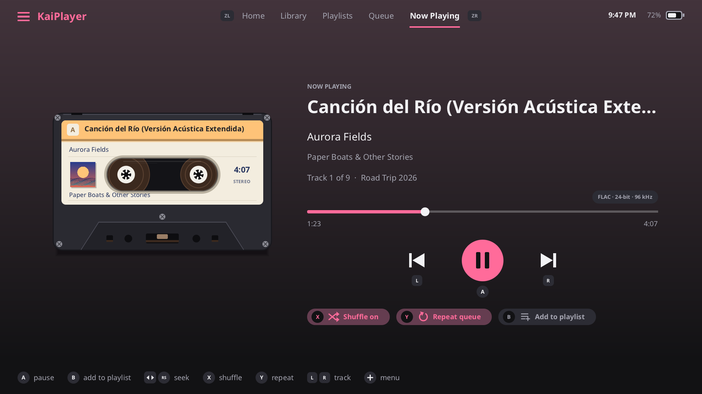
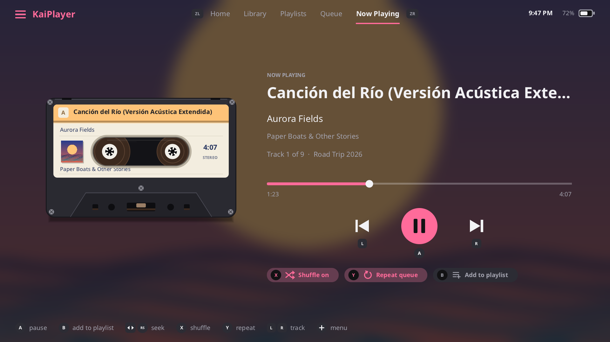

# Settings

[Back to the README](../README.md)

Open **+ → Settings**. It opens on five rows: **Library**, **Network
folder**, **Playback**, **Display** and **About**.

- **A** or **→** opens a page.
- **B** (or the **Back** button) goes back, and **B** on the first page
  closes Settings.
- Change a setting with ← → or **A** (or tap it).

| Page | Setting | Values |
|------|---------|--------|
| Library | Music folder | The folder KaiPlayer shows; **A** chooses another |
| Library | Update the library | **A** looks for new or changed songs |
| Network folder | Address | `\\PC\Music`, `smb://`, or a WebDAV address; **A** types it. See [Network folder](network-folder.md) |
| Network folder | User and password | **A** types them; empty for the folder's guest access |
| Network folder | Test the connection | **A** tries it, and says what's at its top or what went wrong |
| Network folder | Forget this folder | **A** removes the address, user and password |
| Playback | Sleep timer | Off, or any number of minutes up to 600 |
| Playback | Resume where you left off | Keep playing (default), Paused or Off |
| Playback | Equalizer | Off (default), a preset, or Custom; **A** opens the editor |
| Playback | ReplayGain (even loudness) | Off (default), Track, Album or Auto |
| Display | Accent color | Pink (default), Blue, Green, Purple, Orange, Red, or From cover |
| Display | Now Playing style | Cover (default), Vinyl record, CD or Cassette |
| Display | Background | Cover colors (default), or a picture from your `Backgrounds` folder |
| Display | Background blur | Off, Low, Medium (default) or High |
| Display | Clock | 24-hour (default) or 12-hour |
| Playback | Screen off while playing | Never (default), or after 1, 2, 5, 10 or 30 minutes without input |
| — | About | The KaiPlayer version; **A** shows more about the app and its author |

## Sleep timer

- Press **A** (or tap the row) to type the minutes on the number pad, or use
  ← → to change it by 5 minutes. **0** turns it off.
- When the time runs out, the music fades out over 10 seconds and pauses.
- The minutes left show in the top right corner.
- Pausing or changing the song during the fade cancels it.
- The timer isn't saved when you exit.

## Resume where you left off

**Keep playing** reopens the last song and plays on; **Paused** reopens it
paused; **Off** forgets it (and deletes the saved queue). See
[Playback](playback.md#resume-where-you-left-off) for what is saved and when.

## Equalizer

← → on the row steps through Off, the presets (Flat, Bass, Treble, Rock, Pop,
Jazz, Classical, Vocal) and Custom. **A** (or a tap) opens the editor, with
10 bands from 31 Hz to 16 kHz and ±12 dB each:

- ← → choose a band, ↑ ↓ change it by 1 dB. Tap or drag a slider to set it.
- **X** (or tap the preset name) goes to the next preset; **Y** turns the
  equalizer on or off. **B** goes back to Settings.
- Changing a band of a preset turns it into **Custom**, starting from that
  preset. Your Custom settings are saved.
- The overall level is lowered by as much as the loudest boost, so boosting
  bands doesn't make the sound clip.

## ReplayGain

Plays songs at the same loudness, using the `REPLAYGAIN_TRACK_GAIN` /
`REPLAYGAIN_ALBUM_GAIN` tags (Vorbis comments in FLAC and Ogg, `TXXX` frames
in MP3) that tools such as foobar2000, MusicBrainz Picard or `loudgain`
write.

- **Track** levels every song.
- **Album** keeps the differences between songs of an album (and uses the
  track gain if a song has no album gain).
- **Auto** picks for you: album gain when you play a folder in order, and
  track gain for playlists and shuffle, where songs from different albums
  follow each other.

Songs without these tags play as they are. KaiPlayer only turns songs down,
never up, so nothing clips. A new mode applies from the next song.

## Accent color

The color of the highlights, buttons and progress bar. **From cover** takes a
bright version of the most prominent color in the playing song's album art;
black-and-white covers give a silver accent.

## Now Playing style

How Now Playing shows the song.

| Style | What you see |
|-------|--------------|
| **Cover** | The album art, large |
| **Vinyl record** | A black record with the album art as its label, turning at 33⅓ rpm, with the tonearm on it |
| **CD** | A CD with the album art printed on it, turning |
| **Cassette** | A cassette with the title on its label, the artist and album written on its lines, the album art and the song's length beside the window; its reels turn, and the tape winds from the left reel to the right one as the song plays |

They turn only while a song plays, and stop when you pause.

| Vinyl record | CD | Cassette |
|--------------|----|----------|
|  |  |  |

## Background

Instead of the dark background tinted with the album's colors, show a
picture of yours behind every view.

- Put JPEG or PNG images (up to 50 megapixels: photos from a phone or a
  camera are fine) in a folder called **Backgrounds** inside your music
  folder (for example `sdmc:/Music/Backgrounds/`).
- Then choose one here with ← →; **Cover colors** goes back to the tinted
  background.
- KaiPlayer crops the picture to fill the screen, blurs it and darkens it, so
  text stays readable over it.
- **Background blur** sets how much: **Off** keeps it sharp, **High** turns
  it into soft color.
- Use plain file names (no accents): the console hides the others.

## Clock

The top right corner shows the time (24-hour or 12-hour) and the battery
level (green while charging, red at 15% or less).

## Screen off while playing

After that long without touching the console while music plays, the screen
turns off to save battery and the music keeps playing.

- You can also turn it off at once with **+ → Turn screen off**.
- Any button or a touch turns it back on; that press does nothing else.
- Menus don't turn it off while they are open.
- Docked, or if the console doesn't let homebrew control the backlight, the
  screen goes black instead.
